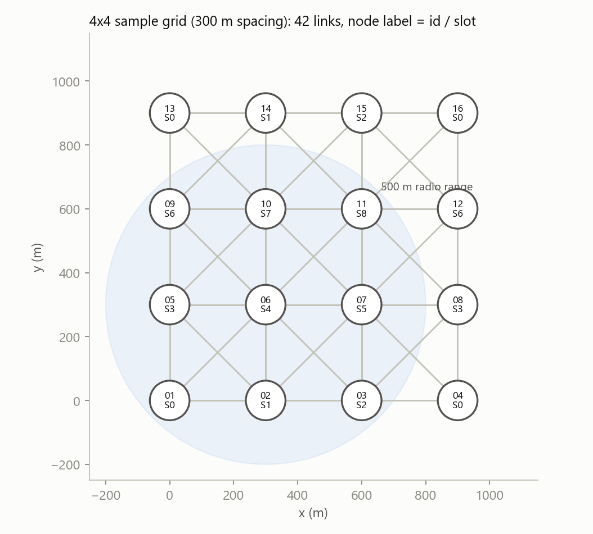
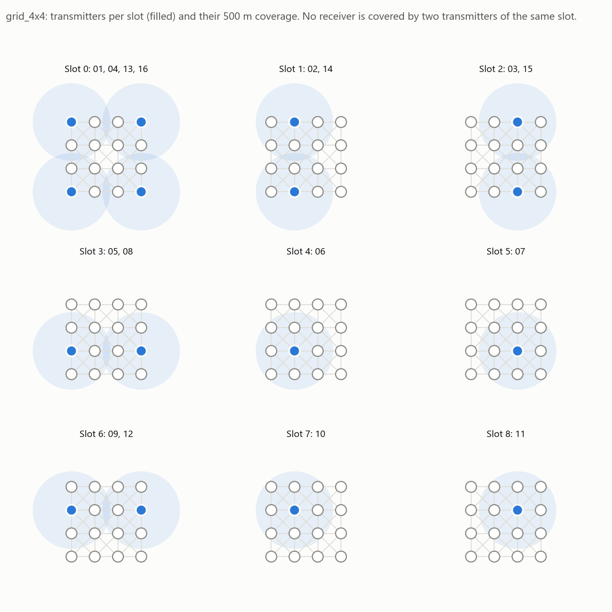
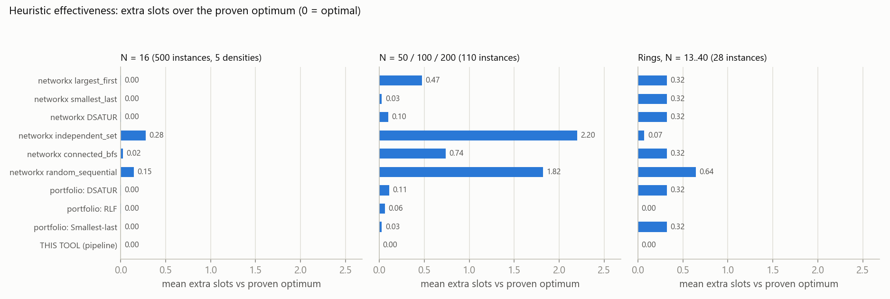
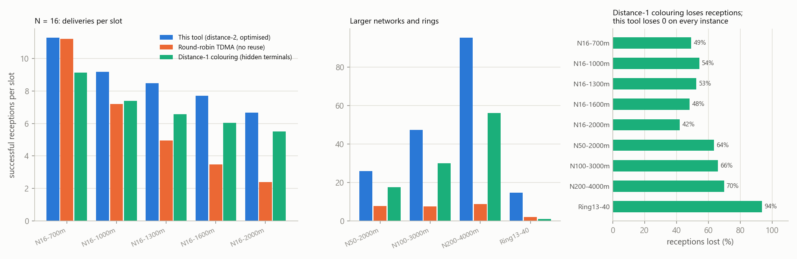
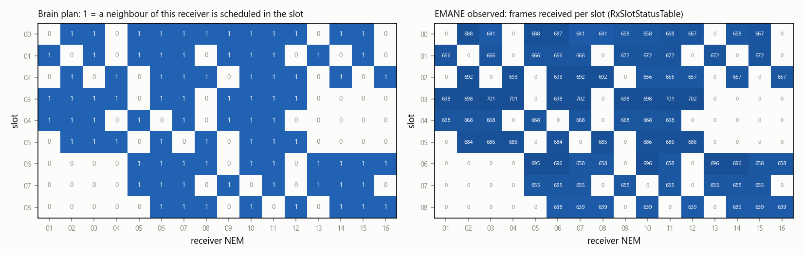
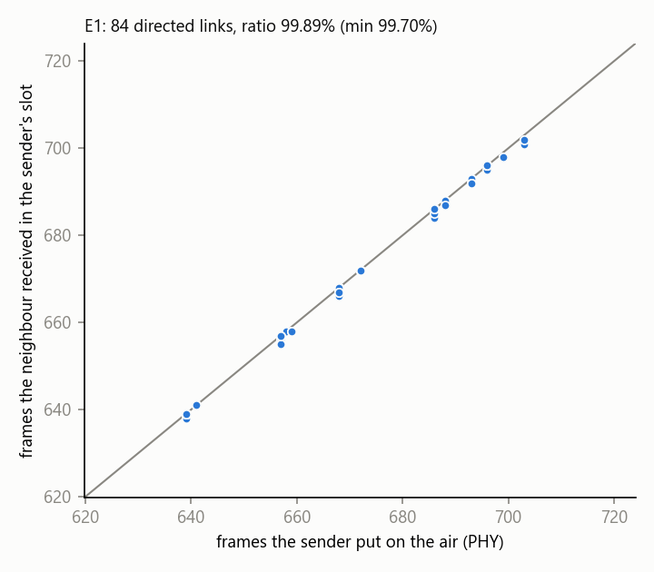
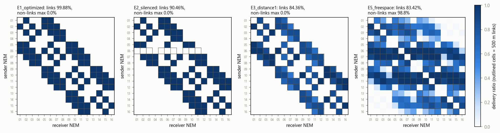
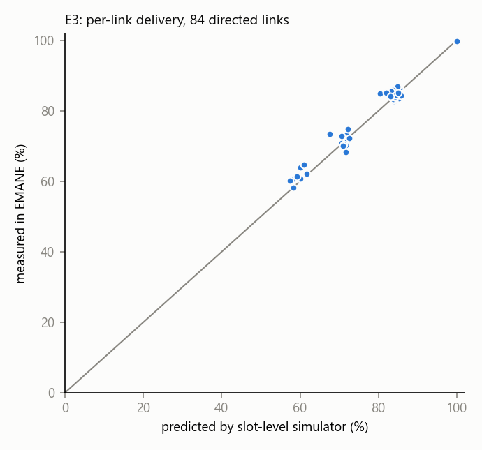

<div class="cover" markdown="1">

# TDMA Schedule Planner &amp; Optimizer

## Distance-2 graph colouring for collision-free TDMA, enforced in EMANE

**Vaan Megam Networks: Full-time Internship on Wireless Protocol Development, technical task**

Prepared by **Sanjay Suresh** · October 2026

| Item | Summary |
|---|---|
| Part 1 (mandatory) | Python "Brain": networkx model, distance-2 colouring, slot minimisation with an optimality proof, CLI in the required format |
| Part 2 (bonus) | EMANE 1.5.3 "Engine": TDMA radio-model profiles with 1 ms slots, an XML **and** ProtoBuf bridge, and a 16-node emulation that enforces the schedule |
| Headline result | Sample 4×4 grid: **9 slots, proven optimal, 0 collisions**. In EMANE: **99.88 %** delivery on links (99.91 % ± 0.06 over 5 seeds), **0 %** off-links, and each sender is heard only in its planned slot |

</div>

<div class="pagebreak"></div>

## Contents

1. Executive summary and final values
2. Problem understanding
3. A finding about the sample output
4. Design process and thought process
5. Part 1: The network model
6. Part 1: The slot optimiser (heuristics and proof)
7. Part 1: CLI, output format, verification and simulation
8. Part 1: Results (sample grid, other topologies, benchmarks)
9. Part 2: EMANE installation and TDMA profiles
10. Part 2: The integration bridge
11. Part 2: Experiments and results
12. Verification strategy and independent reviews
13. How to run
14. Assumptions and known limitations
15. References

Appendix A: full CLI output for the sample grid. Appendix B: generated EMANE files.

<div class="pagebreak"></div>

## 1. Executive summary and final values

The task asks for a centralised scheduler that assigns each radio of a TDMA network a time slot so that no two radios that could interfere ever transmit together. Interference here means radios that are 1 hop apart, or 2 hops apart with a common neighbour. The scheduler should use as few slots as possible. The schedule must then be enforced in an EMANE emulation.

**What was built**

* **The Brain.** `tdma_scheduler.py` and the `tdma_brain` package:
    * builds the 500 m unit-disk graph G with networkx and the conflict graph H = G²;
    * computes a lower bound ω(H) on the number of slots;
    * runs a portfolio of seven colouring heuristics, then iterated greedy, then TabuCol, then an exact branch-and-bound that *proves* optimality;
    * verifies the printed matrix with an independent checker;
    * prints the report in the format of the problem statement.
* **The Engine.** The `emane/` folder:
    * installs EMANE 1.5.3 without root;
    * converts the schedule into EMANE's TDMA schedule XML, or directly into `TDMAScheduleEvent` ProtoBuf messages;
    * runs 16 emulated radios;
    * measures delivery and slot usage from EMANE's own statistics.

**Final values**

| Quantity | Value | Evidence |
|---|---|---|
| Slots for the sample 4×4 grid (300 m spacing, 500 m range) | **9** | `outputs/grid_4x4_report.txt` |
| Lower bound for that grid | 9 (any 3×3 block is a 9-clique of G²) → **proven optimal** | Stage 1 tests; independent reviewer (ILP) |
| Collisions in any produced schedule | **0** | independent verifier; 300 + 638 simulated topologies; EMANE |
| Spatial reuse (grid) | 1.78 transmitters/slot; throughput ×1.78 vs one-node-per-slot TDMA | simulator |
| Benchmark (638 random/ring topologies, N = 13…200) | optimum reached and **proven** on **638/638**; mean runtime 1–2 ms at N = 16, ≤ 44 ms at N = 200 | `benchmarks/results/summary.md` |
| EMANE E1 (Brain schedule) | 16/16 schedules accepted; each sender's frames heard by its neighbours in its planned slot (99.89 %), 0 frames in unscheduled slots; delivery on links **99.88 %** (5 seeds: **99.91 % ± 0.06**), off-links **0 %**; mean latency 5.7 ms (9 ms frame) | `emane/results/summary.md` |
| EMANE E2 (one node's slot removed) | that node: **0 frames** on the air, 0 % delivered, 532 queue-overflow drops; all others 99.99 % | same |
| EMANE E3 (wrong, distance-1 schedule) | 84.8 % ± 0.1 delivery measured (5 seeds) vs **83.9 % predicted** by my simulator; 532 226 bytes lost to SINR (collisions) | same |
| EMANE E4 / E5 (stress tests) | 10× load: 96.6 %, 0 collisions; free-space channel with no 500 m edge: 83.4 % (quantifies the unit-disk assumption) | same |
| EMANE TDMA profile | 1 frame × K slots, **1000 µs slots** (100 µs guard), 2.4 GHz, 12 Mbit/s (1350 B/slot), 10 MHz, 30 dBm | `emane/results/*/scenario/` |
| Tests | **91 automated tests**, all passing | `python -m pytest tests -q` |

<div class="pagebreak"></div>

## 2. Problem understanding

**Restatement.** Radios share one frequency. Time is divided into a repeating frame of equal slots, and each radio may transmit only in its own slot(s). Two failure modes must be avoided:

* **Direct-link interference (distance 1).** If A and B hear each other and transmit together, neither receives the other (half-duplex), and the neighbours they share hear a collision.
* **Hidden terminal (distance 2).** A and C cannot hear each other but share a neighbour B. If they transmit together, their signals collide at B.

Radios more than 2 hops apart may safely reuse a slot. This is **spatial reuse**.

**Mathematical model.** Let G = (V, E) with an edge uv iff ‖p_u − p_v‖ ≤ R = 500 m. A schedule c : V → {0, …, K−1} is collision-free iff c(u) ≠ c(v) whenever d_G(u, v) ∈ {1, 2}. That is exactly a proper colouring of the **square graph** H = G², whose edges join every pair at hop distance 1 or 2. Minimising K means computing the chromatic number χ(G²). This is the classical *broadcast scheduling problem*, which is NP-complete [1, 2]. The PDF therefore asks for heuristics.

**Requirements traced** (full table in `FINAL_REPORT.md`):

* networkx graph with links ≤ 500 m (R1–R2);
* distance-2 colouring as slots (R3–R5);
* spatial reuse (R6);
* heuristics that reduce slots (R7);
* a CLI that takes 16 coordinates as a JSON string (R8–R9);
* a Slot × Node 0/1 matrix plus a Node → Slot mapping in the sample format (R10–R12);
* graded on collision avoidance and heuristic effectiveness (G1–G2);
* EMANE install, TDMA XML profiles with 1 ms slots, frames and frequencies, a bridge to XML or ProtoBuf, and enforcement (R13–R16);
* documentation PDF, Git repository and presentation (R17–R19).

**Implied requirements** I adopted:

* The "verified conflict-free" line must come from an *independent* check.
* Output must be deterministic.
* Input validation must be robust.
* The tool must work on Windows. PowerShell 5.1 strips the quotes from JSON arguments.
* The slot count is reported against a *lower bound*, so "effectiveness" is measurable.
* EMANE's connectivity must equal the 500 m graph, otherwise "enforced strictly by the schedule" is meaningless.

## 3. A finding about the sample output

The sample input `{"Node_01":[0,0],"Node_02":[300,0], …,"Node_16":[900,900]}` is a 4×4 grid with 300 m spacing. With R = 500 m, orthogonal neighbours (300 m) and diagonal neighbours (424.3 m) are linked, so every node hears its up to 8 surrounding nodes. Any **3×3 block** of nodes is pairwise within 2 hops: two nodes of the block are either adjacent or share the block's centre or an edge node as a neighbour. Those 9 nodes need 9 different slots, so **no schedule with fewer than 9 slots exists**. The colouring c(i, j) = 3·(i mod 3) + (j mod 3) achieves 9.

The sample output prints "5 unique timeslots" and gives Node_01 and Node_03 the same slot. Both are neighbours of Node_02, which is a hidden-terminal collision. Checked against its own sample input, the sample assignment has **21 conflicting pairs**. It is therefore a *format template*. This tool reproduces its format (and `--sample-format` reproduces it byte for byte), while computing a correct, provably minimal schedule. Two independent checks confirm this: an automated test (`test_problem_statement_sample_output_is_not_valid_for_the_grid`) and the independent reviewer's own ILP.

<div class="pagebreak"></div>

## 4. Design process and thought process

I worked in five verified stages: model → optimiser → CLI/simulation → EMANE → documentation. Each stage was tested before the next began. The decisions that shaped the solution, and why:

| # | Question | Decision | Reasoning |
|---|---|---|---|
| D1 | Is "within 500 m" `<` or `≤`? | `≤`, on squared distances with a 10⁻¹² relative rounding tolerance (≈ 0.25 nm) | "Within" includes the boundary. Squared distances avoid `sqrt` error. The tolerance only absorbs float rounding (e.g. 500 m along a diagonal). |
| D2 | How to implement distance-2 colouring? | Build H = G² explicitly, then colour H | It reduces the problem to ordinary vertex colouring, so every classical algorithm applies, and the 2-hop rule lives in one audited function. |
| D3 | Which heuristic? | A **portfolio** (DSATUR, RLF, largest-first, smallest-last, connected-BFS, geometric sweep, 64 random orders), then iterated greedy, then TabuCol | No single heuristic wins on every graph. My benchmark confirms the best one changes with the instance. At N = 16 the whole portfolio costs about 1 ms. |
| D4 | How to show the heuristic is *good*? | Exact lower bound ω(G²), plus an exact DSATUR branch-and-bound under a time/node limit | "Lower is better" needs a floor. A proof turns "9 looks good" into "9 is minimal". |
| D5 | Can the "verified" claim be trusted? | A second, independent implementation checks the *printed* matrix: plain Python, no networkx | A bug in graph construction cannot hide from a separate implementation. Tests compare both against networkx BFS. |
| D6 | What does "spatial reuse wherever possible" mean? | The base schedule is a colouring (one slot per node). Optional `--max-reuse` grants extra slots that no node within 2 hops uses | The literal reading is honoured, and the extension adds throughput without any new conflicts. |
| D7 | How to deal with Windows quoting? | Repair the PowerShell-mangled JSON; offer `--file`, `@file` and stdin | Graders may run the exact example on Windows. Tested live on PowerShell 5.1. |
| D8 | How to install EMANE without Docker or sudo? | Rootless: extract the official `.deb`s into a user sysroot; run nodes in unprivileged user/network namespaces | It works within the real constraints and changes nothing on the host system. |
| D9 | How does EMANE learn the 500 m graph? | Precomputed pathloss generated from the same graph (90 dB on links, 200 dB otherwise) | EMANE's connectivity then *is* the Brain's model, which is required for "strictly based on the schedule". |
| D10 | XML or ProtoBuf? | Both, and both are tested (E1 vs E1b) | It satisfies either reading of the requirement. |
| D11 | How to prove enforcement, not just delivery? | Compare, per link, the frames a receiver got in the sender's planned slot (`RxSlotStatusTable`) with the frames the sender put on the air (PHY); count receptions in unscheduled slots; run negative experiments (silenced node, wrong schedule) | Physical events at both ends are causal evidence. EMANE's `TxSlotStatusTable` only lists installed TX opportunities, so it cannot prove behaviour (a reviewer caught my first use of it). |

**Thought process on difficulty.** For random unit-disk deployments, ω(G²) is almost always equal to χ(G²), so good greedy orders already find the optimum and the lower bound proves it. Heuristic quality matters where χ > ω. I therefore added **ring topologies** to the benchmark. In 19 of 28 rings the optimum is one slot above the clique bound, and only the exact search can prove it. The portfolio + proof design is built for exactly this case.

<div class="pagebreak"></div>

## 5. Part 1: The network model

* **Input parsing** (`tdma_brain/parsing.py`):
    * strict JSON;
    * duplicate keys rejected;
    * coordinates must be pairs of finite numbers with |v| ≤ 10⁹ m;
    * booleans, numeric strings, NaN/Infinity, overflow, deep nesting, control characters in names and stray whitespace are all rejected with a clear message and exit code 1.
* **Connectivity graph G** (`topology.py`): nodes in natural order (Node_2 before Node_10), with an edge iff dx² + dy² ≤ R²(1 + 10⁻¹²). The cost is O(N²): 120 pair checks at N = 16.
* **Conflict graph H = G²**: E(H) = E(G) ∪ { ab : a, b ∈ N(w) for some w }. Each edge carries `hops` = 1 or 2. Tests confirm H equals `networkx.power(G, 2)` on 500 random instances.
* **Lower bounds**:
    * Every closed neighbourhood N[v] is a clique in H, so K ≥ Δ(G) + 1.
    * More generally K ≥ ω(H), computed exactly by networkx's maximum-clique branch-and-bound on integer labels (so the result is deterministic).
    * For the grid: Δ + 1 = 9 and ω = 9.

**Worked example.** A(0,0), B(400,0), C(800,0), D(1600,0).

1. Squared distances: AB = BC = 160 000 ≤ 250 000, so those are links. AC = 640 000, so not a link. D is isolated.
2. H adds AC (hops = 2, via B).
3. Lower bound: ω = 3, from N[B].
4. Schedule A→0, B→1, C→2, D→0 has K = 3 = LB, so it is optimal. D reuses slot 0 because it is more than 2 hops from A.

## 6. Part 1: The slot optimiser

The pipeline (`optimizer.py`) stops as soon as K equals the lower bound:

1. **Constructive portfolio** (`coloring.py`):
    * **DSATUR** (Brélaz [5]) repeatedly colours the vertex whose neighbours already use the most distinct colours.
    * **RLF** (Leighton [6]) builds one maximal independent set (one slot) at a time, always adding the vertex that removes the most conflicts.
    * **Largest-first** (Welsh–Powell) is greedy colouring in descending degree order.
    * **Smallest-last** (Matula–Beck [7]) colours in reverse degeneracy order, which uses at most degeneracy + 1 colours.
    * **Connected-BFS** and **geometric sweep** (lexicographic x, y) are further vertex orders.
    * **64 seeded random orders** add diversity.
2. **Iterated greedy** (Culberson–Luo [8]). Re-run greedy in an order that keeps the previous colour classes together. Because each class stays independent, the colour count **can never increase**.
3. **TabuCol** (Hertz–de Werra [9]). For fixed k, minimise the number of conflicting edges by recolouring conflicting vertices. Reverse moves are tabu for rand(0..9) + 0.6·|conflicts| iterations, with aspiration. It tries K−1, K−2, …
4. **Exact DSATUR branch-and-bound** (Brélaz; San Segundo [10]). It branches over feasible existing colours and then over one new colour only while that stays below the incumbent. The maximum clique is pre-coloured to break symmetry. A deterministic node limit (2·10⁶) and a time limit apply. If the search tree is exhausted, the result is **proven optimal**.
5. **Canonical relabelling** numbers the slots by first appearance in node order, so Node_01 is always slot 0. The output is deterministic.
6. **Optional max-reuse.** In each round-robin pass, every node may gain one more slot s if no node within 2 hops already transmits in s. The frame length is unchanged and the schedule stays collision-free.

**Correctness cross-checks.**

* The B&B optimum equals a scipy/HiGHS **ILP** optimum on 120 random instances, and brute force on 150 small ones.
* Every heuristic always produces a proper colouring.
* The independent reviewer found no false optimality claim on 159 adversarial graphs, including Mycielski graphs.

## 7. Part 1: CLI, output format, verification, simulation

`python tdma_scheduler.py '<JSON>'` prints the report in the sample's layout:

* the `=` rules and title;
* the *Total Nodes Processed / Configured Radio Range / Optimized Frame Length* lines;
* the *NODE -> SLOT ASSIGNMENTS* list;
* the `Slot \ Node | 01 | … | 16` matrix;
* the closing *Execution finalized cleanly. Schedule verified conflict-free.* line.

Three extra header lines state the lower bound with the optimality status, the spatial-reuse factor and the chosen heuristic. One line before the end reports the independent verification. `--sample-format` drops the extras and reproduces the sample's spacing exactly.

The **verifier** (`verify.py`) recomputes adjacency from the raw coordinates without networkx. For each slot row it checks every pair of transmitters for "adjacent" or "common neighbour". It also checks that every node has a slot, that the mapping agrees with the matrix, and that no slot is empty. If any check fails, the CLI prints the conflicts and exits with code 2. This has never happened.

The **slot-level simulator** (`simulator.py`) replays the frame with broadcast traffic. A reception at r from t succeeds iff r is not itself transmitting and t is the only transmitting neighbour of r. It compares the optimised schedule with round-robin TDMA (no reuse) and with a distance-1 colouring (no hidden-terminal rule). In 1 000 random schedules, the simulator reports losses **iff** the verifier reports a conflict: two different formulations agree.

<div class="pagebreak"></div>

## 8. Part 1: Results

### 8.1 Sample grid



The optimised schedule (full output in Appendix A) uses **9 slots**:

* Slot 0 is shared by the four corners (01, 04, 13, 16).
* Slots 1, 2, 3 and 6 are shared by pairs of edge nodes 900 m apart.
* The four inner nodes each need their own slot.

The small multiples below show, for each slot, the transmitters (filled) and their 500 m coverage. No receiver lies inside two discs of the same slot.



| Schedule for the grid | Slots | Deliveries per frame | Deliveries per slot | Receptions lost |
|---|---|---|---|---|
| **This tool (distance-2, optimal)** | **9** | 84 (every directed link) | **9.33** | **0** |
| Round-robin TDMA (no reuse) | 16 | 84 | 5.25 | 0 |
| Distance-1 colouring (no hidden-terminal rule) | 4 | 20 | 5.00 | 64 per frame (76 % of links never served) |

### 8.2 Other 16-node topologies (`inputs/`, all proven optimal, 0 conflicts)

| Topology | Slots | Comment |
|---|---|---|
| random_16 (1.5 km square) | 8 | 2 components; `--max-reuse` raises transmissions/frame from 16 to 26 |
| clustered_16 (3 teams) | 6 | far-apart clusters reuse the same slots |
| line_16 (convoy, 400 m) | 3 | pattern 0,1,2,0,1,2,… |
| ring_16 | 4 | ω = 3 but χ = 4: **proven by exhaustive branch-and-bound** |
| dense_16 (300 m square) | 16 | everyone hears everyone, so no reuse is possible |

### 8.3 Benchmark: effectiveness of the heuristics

638 instances: 500 at N = 16 over 5 densities, 110 at N = 50/100/200, and 28 jittered rings at N = 13–40. All are seeded and reproducible (`benchmarks/run_benchmarks.py`).



* The pipeline reached the optimum and **proved it on all 638 instances**. Mean runtime is 1–2 ms at N = 16 and at most 44 ms at N = 200.
* Every *single* heuristic misses the optimum on some set. For example, networkx `independent_set` misses on 100 % at N = 200, and even smallest-last misses on 32 % of the rings.
* On rings, RLF (in the portfolio) finds the optimum every time, but only the exact search can certify it, because the optimum exceeds the clique bound.
* **Honest note:** on random unit-disk graphs the best of all seven networkx strategies, taken together, is usually already optimal. The pipeline beat that combined best on 1 instance. The value of the pipeline is reaching the optimum *every* time, with a proof.



<div class="pagebreak"></div>

## 9. Part 2: EMANE installation and TDMA profiles

* **Installation.** EMANE 1.5.3 (released July 2025) was installed on WSL2 Ubuntu 24.04 from the official Adjacent Link bundle [11], whose SHA-256 is verified before installation.
    * Neither Docker nor a sudo password was available. `emane/install_rootless.sh` extracts the needed packages with `dpkg-deb -x` into `~/vmn-emane/sysroot` and fetches missing libraries (libprotobuf, python3-protobuf, libpcre3, …) from the Ubuntu archive.
    * Experiments run inside an unprivileged user + network + mount namespace. Nothing on the system is modified.
    * `emane/docker/Dockerfile` provides the "one consolidated container" alternative. It follows the official instructions and is clearly marked as *not built here*.
* **TDMA radio-model profile** (the official emane-guide template, parameterised by the bridge):
    * **Schedule structure:** 1 frame per multiframe, K slots per frame (K = 9 for the grid), `slotduration` **1000 µs**, `slotoverhead` 100 µs (a guard far above the 1.7 µs propagation delay over 500 m), bandwidth 10 MHz.
    * **Multiframe:** frequency **2.4 GHz**, power 30 dBm, class 0, data rate 12 Mbit/s. That gives 12·10⁶ × 900·10⁻⁶ / 8 = **1350 bytes per slot**.
    * **MAC** (`tdmaeventschedulerradiomodel`): queue depth 255, fragmentation and aggregation on, PCR curve `tdmabasemodelpcr.xml` (12 Mbit/s: 0 % reception at SINR ≤ 3 dB, 100 % at ≥ 9 dB).
    * **PHY:** noise mode `all` (overlapping signals interfere), propagation model `precomputed`, noise figure 4 dB, subid 7.
    * **Transport:** virtual transport (TAP `emane0`, 10.100.0.N/24).
    * **Platform:** OTA channel 224.1.2.8:45702 and event channel 224.1.2.8:45703 on `backchan0`, control port 47000.

## 10. Part 2: The integration bridge

`emane/bridge/schedule_to_emane.py` reads the JSON written by `tdma_scheduler.py --json-out`. That JSON carries nodes, NEM ids, coordinates, the Slot × Node matrix and the 500 m links. The bridge produces:

1. **`schedule.xml`**, an EMANE full schedule. Matrix row s becomes `<slot index="s" nodes="…"/>`. In EMANE a defined slot defaults to **TX** for the listed NEMs, and every other slot defaults to **RX**: exactly half-duplex TDMA.
    * The XML is validated against **EMANE's own `tdmaschedule.xsd`**, then re-parsed and compared with the intended slots (round-trip).
    * A silenced node (experiment E2) is referenced with explicit `<rx/>` in every slot.
2. **ProtoBuf route.** `publish_events.py --route protobuf` builds one `TDMAScheduleEvent` per NEM directly from the per-node slots with EMANE's Python API: `structure(slots, frames, slotduration, slotoverhead, bandwidth)` and `append(frame, slot, type='tx'|'rx', …)`. `--route xml` instead parses the XML with EMANE's `TDMASchedule` class, exactly like `emaneevent-tdmaschedule`.
3. **Channel model.** `pathloss.json` holds 90 dB on links and 200 dB otherwise, published as `PathlossEvent`s.
    * Link budget: 30 − 90 = −60 dBm against a noise floor of −174 + 70 + 4 = −100 dBm, so SNR = 40 dB and frames are always decoded.
    * Non-neighbours arrive at −170 dBm, which is invisible.
    * Two equal-power overlapping frames give SINR ≈ 0 dB, which is lost.
4. Per-node `platform-NN.xml`, the shared NEM/MAC/transport XML, `nodes.json` and `scenario.json`.

The generated schedule for the grid (Appendix B) has the same 9 slots as the Brain's matrix.

## 11. Part 2: Experiments and results

**Testbed** (`emane/runner/`):

* a hub bridge with 16 node network namespaces, all inside one unprivileged user + network + mount + PID namespace;
* one EMANE platform per node, with IPv6 disabled so that only probe traffic uses the radio;
* pathloss and schedule events published from the hub;
* **traffic starts only after every NEM reports the full schedule accepted** (`scheduleAcceptFull = 1`, 0 rejects);
* each node sends Poisson UDP broadcast probes for 20 s, with exact one-way latency (shared clock);
* statistics are collected from every NEM's control port.

**How enforcement is proven.** The evidence is non-circular, from physical events at both ends. Take every directed link t → r where t is the only neighbour of r scheduled in t's slot. Compare:

* the frames r received in that slot (EMANE `RxSlotStatusTable` at r), with
* the frames t actually put on the air (EMANE PHY `BroadcastPacketAcceptTable0` at t).

Frames received in a slot where r has *no* scheduled neighbour are counted separately as "stray" receptions, which must be 0. EMANE's `TxSlotStatusTable` is **not** used as evidence. It lists the TX *opportunities* of the installed schedule, so it only confirms that the schedule was installed. The independent reviewer pointed this out about my first analysis; see §12.

| Experiment | Slots | Load (pkt/s/node) | Delivery on 500 m links (mean / min) | Non-links (max) | Frames heard in sender's slot / sent | Stray valid receptions | Collision (SINR) drops |
|---|---|---|---|---|---|---|---|
| **E1** Brain schedule, XML route | 9 | 40 | **99.88 % / 99.38 %** | **0.00 %** | **99.89 %** (min 99.70 %, 84 links) | **0** | **0** |
| **E1b** same, ProtoBuf route | 9 | 40 | 99.93 % / 99.51 % | 0.00 % | 99.93 % | 0 | 0 |
| **E2** Node_06's TX slot removed | 9 | 40 | others 99.99 %; **Node_06: 0.0 %, 0 PHY frames** | 0.00 % | 99.98 % | 0 | 0 (532 queue overflows) |
| **E3** distance-1 schedule (wrong) | 4 | 40 | **84.36 % / 58.21 %** | 0.00 % | 99.58 % (20 unshared links) | 0 | **532 226 B** |
| **E4** E1 at 10× load | 9 | 400 | 96.63 % / 93.42 % | 0.00 % | 96.78 % | 0 | 0 |
| **E5** E1 over free space, every pair | 9 | 40 | **83.42 % / 41.55 %** | **98.83 %** | n/a (channel ≠ planned graph) | n/a | **4 910 450 B** |

All 16 NEMs accepted every schedule, with 0 rejects, in all runs. **Replication** with traffic seeds 1–5:

* E1: **99.91 % ± 0.06** (95 % CI);
* E3: **84.78 % ± 0.13**, against **83.9 %** predicted by my slot-level simulator.





**Interpretation**

* **Permitted where planned.** Every scheduled link delivers. Each sender's frames are heard by its neighbours in its planned slot (99.89 %, at least 99.70 % on every link). No frame arrives in a slot where the receiver has no scheduled neighbour (0 in every run), and nothing crosses a non-link (0 %).
* **Dropped where the schedule says.**
    * A node without a TX slot puts **0 frames** on the air. Its 787 probes minus the 255-packet queue depth give exactly 532 overflow drops.
    * A schedule that violates the 2-hop rule collides at the hidden-terminal receivers the verifier names: MAC SINR drops and RX-lock errors.
* **Latency follows TDMA theory.** The wait for one's slot is uniform over the frame, so the mean is half a frame (4.5 ms for 9 slots) plus about one slot. Measured: 5.73 ms mean and 10.15 ms p99, close to frame + slot = 10 ms. With the 4-slot frame of E3: 3.24 ms.
* **Independent model check.** For E3, the simulator and EMANE agree link by link: about 60 % with two hidden interferers, about 85 % with one, 100 % with none. EMANE runs a reproducible 0.9 pp above the simulator. The likely cause is EMANE's packet aggregation (two queued probes leave in one transmission); I identified this but did not test it separately.
* **Residual E1 loss (0.12 %) is host timing, not scheduling.**
    * EMANE missed 0.16 % of TX slots (76 of 47 703), and avgTimedEventLatency was 108–117 µs.
    * Every log contains "Unable to set Real Time Priority": a rootless run cannot use realtime scheduling.
    * There were 0 SINR drops and 0 RX-during-TX errors.
* **E4 (10× load).** Several probes are aggregated per 1 ms slot (1350 B), with 0 queue overflows and 0 collisions. The 3.4 % loss is slot-boundary timing errors with longer frames on this host.
* **E5 (physical channel, a deliberate stress test of the task's assumption).** With free-space loss for every pair (3 dBm, so the 100 % decode edge is about 500 m), there is no hard edge:
    * 600 m pairs are still received about 98 % of the time;
    * co-slot transmitters 900 m apart are only about 6.5 dB weaker than a 424 m link, below the 9 dB that 12 Mbit/s needs.
    * The 500 m distance-2 schedule therefore collides.
    * The remedy is a modelling choice inside the Brain: plan with an interference radius (`--range`) that covers the real interference range, use power control, or use a lower data rate with a lower SINR threshold.





<div class="pagebreak"></div>

## 12. Verification strategy and independent reviews

* **91 automated tests** (pytest) cover:
    * parsing edge cases and the inclusive 500 m boundary;
    * G² vs `networkx.power` (500 instances);
    * the verifier vs brute-force BFS (1 500 schedules) and mutation tests (300);
    * heuristics always proper; B&B vs ILP (120) and brute force (150);
    * optimiser ≥ every networkx strategy (300);
    * printed output re-parsed and re-verified for every input;
    * all input forms, including PowerShell-mangled JSON;
    * the simulator: 0 losses for every optimised schedule (300 topologies), and losses iff conflicts (1 000);
    * regression tests for every reviewer-found defect;
    * identical output under different Python hash seeds;
    * the EMANE bridge: XSD-valid, round-trip, pathloss consistency, silencing, max-reuse.
* **Independent reviewer 1 (Part 1).** A separate AI reviewer with no access to the design reasoning ran 320 fuzzed CLI runs with its own checker, an ILP and adversarial inputs.
    * It found **no collision and no false optimality claim**.
    * It reported 8 robustness defects at the input/output boundary: encoding on redirected output, overflow paths, Unicode digits in names, exit-code mismatch, a micrometre-scale range tolerance, and name sanitising. **All 8 were fixed**, each with a regression test (`reports/stage_3_report.md`).
* **Independent reviewer 2 (Part 2).** A separate AI reviewer recomputed every EMANE number from the raw files and found them consistent with the summary. It confirmed the schedule XML, the ProtoBuf events and the pathloss events are correct and accepted by EMANE.
    * **It also found a real flaw.** My first "each node transmits only in its slot" evidence came from `TxSlotStatusTable`, which lists TX *opportunities*, so it compared the schedule with itself. I replaced it with the receiver-side test in §11.
    * **Other fixes from that review:** traffic gated on schedule acceptance; IPv6 disabled; per-process exit checks and start-skew logging; a PID namespace for cleanup; bundle SHA-256 verification; 5-seed replication; the high-load (E4) and physical-channel (E5) runs; and two corrected claims (no capture effect on this grid; realtime `-r` only outside a user namespace). Details: `reports/stage_4_report.md`.
* **Reproducibility.** One issue was found during re-runs: three *networkx* baseline strategies depend on Python's string-hash seed. The benchmark pins the seed, and my own algorithms use integer indices. Benchmark tables are identical across runs.

## 13. How to run

```
pip install -r requirements.txt
python tdma_scheduler.py --file inputs/grid_4x4.json            # the mandated report
python tdma_scheduler.py '{"Node_01":[0.0,0.0], ... }'          # JSON string argument
python tdma_scheduler.py --file inputs/random_16.json --verbose --max-reuse --simulate 100
python tdma_scheduler.py --file inputs/grid_4x4.json --json-out schedule.json
python -m pytest tests -q
# Part 2 (Linux / WSL2 Ubuntu 24.04):
bash emane/install_rootless.sh
bash emane/runner/run_experiments.sh 20 40
python3 emane/analysis/analyze.py
```

## 14. Assumptions and known limitations

* **Interference model.** The unit-disk / protocol model is used: interference range = communication range = 500 m. This is exactly the model the task defines, and the EMANE channel in E1–E4 is deliberately set to it. E5 quantifies the gap: with free-space propagation the interference range exceeds 2 hops and the 500 m schedule collides (83.4 % delivery). Remedies are planning with a larger interference radius (`--range`), power control, or a lower data rate.
* **Node-based broadcast scheduling.** Each node gets one slot per frame, as the task defines. Link (unicast) scheduling, traffic-dependent slot counts and dynamic or mobile topologies are outside the stated problem.
* **NP-hardness.** At large N the exact certificate may hit its limits. The tool then reports "best found; optimum in [LB, K]". This never happened on any benchmark instance up to N = 200.
* **EMANE.** It ran rootless on WSL2 without realtime priority, missing 0.13–0.47 % of TX slots per run; this causes the 0.1 % residual loss in E1 and the 3.4 % in E4. Only broadcast traffic was tested. The Dockerfile was not built (no Docker on the development machine).

## 15. References

1. A. Ephremides, T. Truong, "Scheduling broadcasts in multihop radio networks," *IEEE Trans. Communications* 38(4):456–460, 1990.
2. S. Ramanathan, E. L. Lloyd, "Scheduling algorithms for multihop radio networks," *IEEE/ACM Trans. Networking* 1(2), 1993.
3. S. O. Krumke, M. V. Marathe, S. S. Ravi, "Models and approximation algorithms for channel assignment in radio networks," *Wireless Networks* 7, 2001.
4. A. H. Gebremedhin, F. Manne, A. Pothen, "What color is your Jacobian? Graph coloring for computing derivatives," *SIAM Review* 47(4):629–705, 2005; S. T. McCormick, *Math. Programming* 26:153–171, 1983.
5. D. Brélaz, "New methods to color the vertices of a graph," *Communications of the ACM* 22(4):251–256, 1979.
6. F. T. Leighton, "A graph coloring algorithm for large scheduling problems," *J. Research NBS* 84(6):489–506, 1979.
7. D. W. Matula, L. L. Beck, "Smallest-last ordering and clustering and graph coloring algorithms," *J. ACM* 30(3):417–427, 1983.
8. J. C. Culberson, F. Luo, "Exploring the k-colorable landscape with iterated greedy," DIMACS Series vol. 26, AMS, 1996.
9. A. Hertz, D. de Werra, "Using tabu search techniques for graph coloring," *Computing* 39:345–351, 1987.
10. P. San Segundo, "A new DSATUR-based algorithm for exact vertex coloring," *Computers &amp; Operations Research* 39(7):1724–1733, 2012.
11. Adjacent Link LLC, EMANE 1.5.3 and the *EMANE Guide: TDMA Radio Model*, https://emane.io/tdma-radio-model ; install: https://github.com/adjacentlink/emane/wiki/Install
12. NetworkX documentation, `greedy_color`, https://networkx.org/documentation/stable/reference/algorithms/generated/networkx.algorithms.coloring.greedy_color.html
13. A. Gräf, M. Stumpf, G. Weißenfels, "On coloring unit disk graphs," *Algorithmica*, 1998.

<div class="pagebreak"></div>

## Appendix A: CLI output for the sample grid

```
{{GRID_REPORT}}
```

## Appendix B: Generated EMANE schedule for the sample grid

```
{{GRID_SCHEDULE_XML}}
```

Platform file for node 6 (`platform-06.xml`, as generated for the run; the DTD path points into the rootless EMANE sysroot):

```
{{PLATFORM_06}}
```
